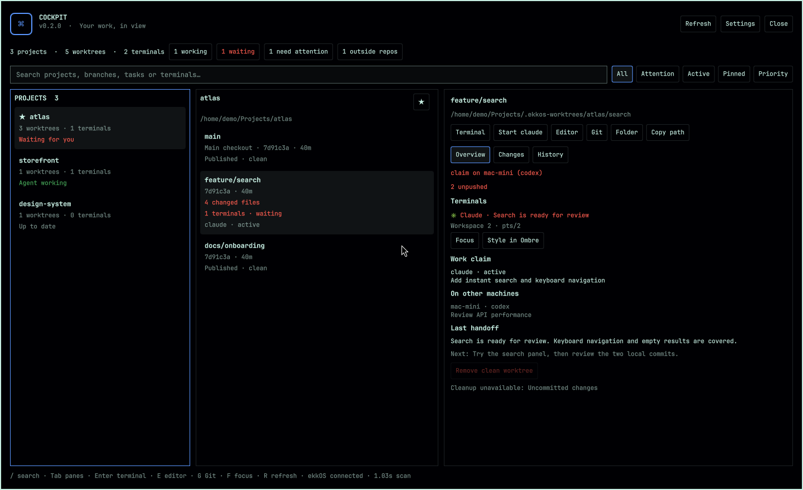
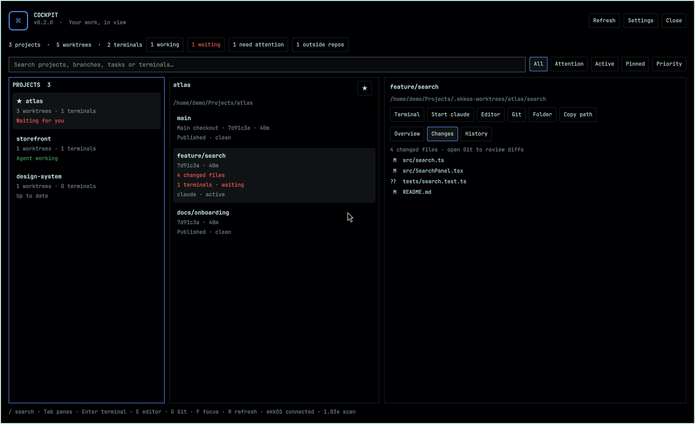

# Cockpit

Your projects, worktrees and coding agents in one keyboard-driven dashboard for Omarchy. Find what needs attention, inspect the work, and jump straight to its terminal, editor or Git view.



*The real plugin, captured with demo projects and terminal titles.*

## What it does

- **A three-pane workspace:** projects on the left, their worktrees in the middle, and actions and details on the right. Selection follows paths and stays put when the inventory refreshes.
- **Attention at a glance:** working and waiting terminals, uncommitted files, unpushed commits, remote work claims and unavailable Git status. Filter to All, Attention, Active or Pinned projects, and sort by priority or name.
- **Search that works:** type in the search field, or use `/` or `Ctrl+F`. Match project names, paths, branches, claim tasks, terminal titles and workspace names. Several words narrow the results together.
- **Pinned projects and custom scan folders:** star a project, or add folders in Settings. Preferences persist in `~/.config/omarchy/cockpit.json` and are written atomically with private permissions.
- **Useful actions:** open a terminal, start your configured coding agent, launch your default editor, open lazygit or the folder, and copy the worktree path. Each terminal has its own Focus and Style in Ombre buttons.
- **Inspect before switching:** Changes lists modified files, History shows recent commits, and Overview shows terminals, local and remote work claims, and the latest project handoff when ekkOS Personal is available.
- **Terminals outside repos:** the summary button exposes terminals that could not be assigned to a worktree, so you can still focus or style them.
- **Careful cleanup:** remove a clean, published worktree with a confirmation. The backend rechecks Git status, live terminals, active claims, locks and installed-plugin references immediately before removal.



## Install

```bash
omarchy plugin add https://github.com/ekkostech/omarchy-cockpit.git --enable --yes
omarchy restart shell
```

Add a shortcut in `~/.config/hypr/bindings.lua`:

```lua
o.bind("SUPER + ALT + C", "Cockpit", "omarchy-shell shell toggle ekkostech.cockpit '{}'")
```

Update an existing Git-managed installation with:

```bash
omarchy plugin update ekkostech.cockpit --yes
omarchy restart shell
```

## Keys

| Key | Action |
|---|---|
| `/` or `Ctrl+F` | Focus search |
| `↑` / `↓`, `J` / `K` | Move through the current pane |
| `Tab`, `←` / `→`, `H` / `L` | Switch project/worktree panes |
| `Enter` / `T` | Open a terminal in the selected worktree |
| `A` | Start the configured default agent |
| `E` | Open the default editor |
| `G` | Open lazygit |
| `F` | Focus the first terminal in the selected worktree |
| `R` | Refresh |
| `Esc` | Clear search, close settings, or dismiss |

The search field uses normal text editing; Enter returns focus to navigation. Every action is also visible as a button. To focus a particular terminal, use its own Focus button.

## Discovery and data

By default Cockpit finds repositories under `~/Projects`, `~/code`, `~/src`, `~/dev` and `~/Work`, three levels deep, plus repositories containing a running terminal. Registered Git worktrees are discovered from their main repository, including centralized `.ekkos-worktrees` directories.

Adding custom scan folders replaces those defaults; removing all custom folders restores them. Inventory refreshes every ten seconds while open. Git worktrees are inspected concurrently. A failed refresh keeps the last inventory visible with an error; inaccessible Git state is never presented as clean.

Ahead/behind and published status reflect **locally known remote refs from your last fetch**. Cockpit does not fetch or push repositories automatically. Agent activity is inferred from supported terminal-title indicators, not from an agent's private conversation.

With ekkOS Personal installed, Cockpit reads `work status` and project `handoffs`. Claims belong to their existing agents. Starting another agent in an actively claimed worktree is blocked; focus its existing terminal or coordinate that claim first. Handoff text is displayed as context and is never executed.

Cleanup blocks the main checkout, locked worktrees, uncommitted changes, active claims, live terminals, commits absent from known remote branches and worktrees used by installed plugins. If terminal or claim information is unavailable, cleanup is blocked. There is no force-delete shortcut. Use Git and ekkOS directly when a worktree needs manual recovery.

## Scripting

```bash
# Current inventory, including source status and scan duration
~/.config/omarchy/plugins/ekkostech.cockpit/bin/cockpit-scan

# Inspect a different workspace without changing saved settings
~/.config/omarchy/plugins/ekkostech.cockpit/bin/cockpit-scan --root ~/work

# Running overlay version and summary
omarchy-shell shell call ekkostech.cockpit status ''
```

Window titles and JSON payloads stay in process memory and pipes, never shell command strings. Scan errors and missing dependencies are reported in the interface.

## Requirements

Omarchy 4 with Quickshell and Hyprland, Git and Python 3. ekkOS Personal and Ombre are optional. Editor, lazygit and clipboard buttons use installed commands; unavailable integrations are disabled. Starting an agent uses the existing Omarchy default and does not install one.

## Development

```bash
node --test tests/*.test.js
python3 -m py_compile bin/cockpit-scan
omarchy plugin validate .
```

The Qt integration test runs when the Omarchy shell modules and Quickshell are available. Run it from the desktop session (or export its Wayland environment over SSH). Other tests run on standard Node/Python installations and create temporary Git repositories.

## Uninstall

```bash
omarchy plugin remove ekkostech.cockpit
```

MIT licensed.
